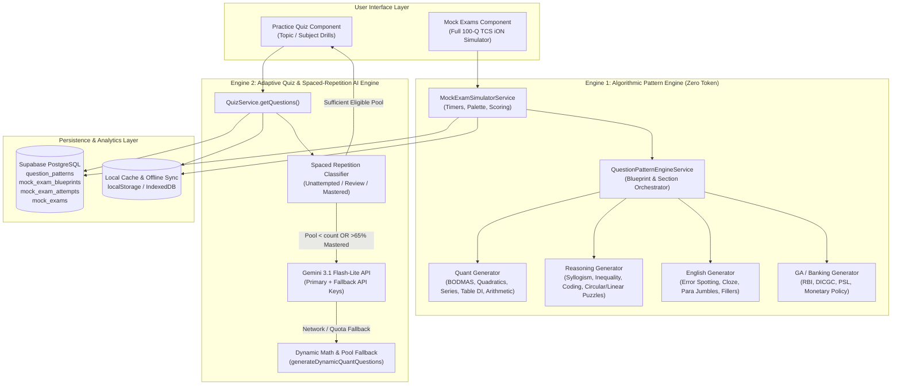
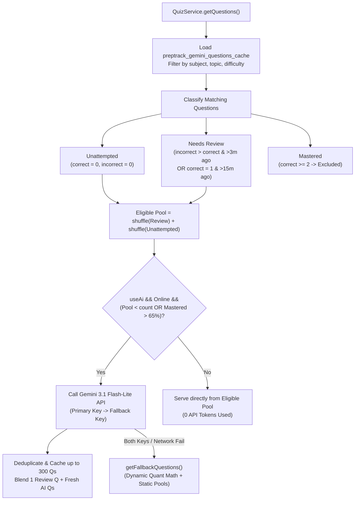

# PrepTrack Question Generation Module — Complete Technical Guide

This document explains the end-to-end architecture, mathematical algorithms, data structures, and persistence workflows of the **Question Generation Module** in PrepTrack.

---

## 1. High-Level Architecture: The Dual-Engine Design

PrepTrack uses a **Dual-Engine Question Generation Architecture** designed to provide unlimited, realistic Indian Bank Exam practice (IBPS PO, SBI PO, IBPS Clerk, RBI Grade B) while keeping AI token usage near zero for full-length 100-question simulations.

### Summary of the Two Engines

| Feature | Engine 1: Algorithmic Pattern Engine | Engine 2: Adaptive Practice & AI Quiz Engine |
| :--- | :--- | :--- |
| **Core Service** | [`QuestionPatternEngineService`](file:///d:/git/Bank/PrepTrack-Exam-Preparation-Tracker/src/app/core/services/question-pattern-engine.service.ts) | [`QuizService`](file:///d:/git/Bank/PrepTrack-Exam-Preparation-Tracker/src/app/core/services/quiz.service.ts) |
| **Primary Use Case** | Full-length 100-question / 60-minute Mock Exams & 30-question Mixed Sprints | Targeted 5–20 question topic/subject drills & Previous Year Papers |
| **Options per Question** | **5 Options (`A` to `E`)** — matches official IBPS/SBI TCS iON interface | **4 Options (`A` to `D`)** — rapid drill format |
| **AI Token Cost** | **0 Tokens** (100% client-side deterministic & parametric math/logic) | **Smart-gated Gemini API** (only called when local bank is >65% mastered or low on questions) |
| **Grouped Passages** | Supports multi-question split-screen sets (5-Q Table DI, 5-Q Seating Puzzles, 5-Q Cloze Test, 5-Q Para Jumbles) | Standalone MCQs with step-by-step explanations |

---

## 2. Engine 1: Algorithmic Mock Exam Pattern Engine

Implemented in [`QuestionPatternEngineService`](file:///d:/git/Bank/PrepTrack-Exam-Preparation-Tracker/src/app/core/services/question-pattern-engine.service.ts) and orchestrated by [`MockExamSimulatorService`](file:///d:/git/Bank/PrepTrack-Exam-Preparation-Tracker/src/app/core/services/mock-exam-simulator.service.ts).

### 2.1 Exam Blueprints (`MockExamBlueprint`)

Every simulated exam starts from a [`MockExamBlueprint`](file:///d:/git/Bank/PrepTrack-Exam-Preparation-Tracker/src/app/core/models/database.types.ts#L325-L338) returned by [`getDefaultBlueprints()`](file:///d:/git/Bank/PrepTrack-Exam-Preparation-Tracker/src/app/core/services/question-pattern-engine.service.ts#L18-L201). A blueprint defines:
- **Exam Metadata**: `id`, `title`, `exam_category` (`IBPS_PO`, `SBI_PO`, `IBPS_CLERK`, `MIXED_SPRINT`), `exam_stage` (`prelims` | `mains`), `target_cutoff`.
- **Timing & Marking Rules**: `total_duration_minutes`, `has_sectional_timing` (`true` locks users to 20 minutes per section), `total_marks`, `negative_marking` (`0.25`).
- **Sections Array (`sections_config`)**: Ordered list of [`MockExamSectionConfig`](file:///d:/git/Bank/PrepTrack-Exam-Preparation-Tracker/src/app/core/models/database.types.ts#L314-L323) objects specifying `subjectCode`, `questionsCount`, `durationMinutes`, `marksPerQuestion`, `negativeMarks`, and `cutoffEstimate`.

#### Built-in Exam Blueprints

| Blueprint ID | Exam Category | Total Qs | Duration | Sectional Timing | Target Cutoff | Section Breakdown |
| :--- | :--- | :---: | :---: | :---: | :---: | :--- |
| `ibps-po-prelims-live-1` | `IBPS_PO` | 100 | 60m | Yes (20m × 3) | 54.50 | English (30), Quant (35), Reasoning (35) |
| `sbi-po-prelims-live-1` | `SBI_PO` | 100 | 60m | Yes (20m × 3) | 58.75 | English (30), Quant (35), Reasoning (35) |
| `ibps-clerk-prelims-mock-1` | `IBPS_CLERK` | 100 | 60m | Yes (20m × 3) | 74.00 | English (30), Numerical Ability (35), Reasoning (35) |
| `mixed-sprint-mini-mock` | `MIXED_SPRINT` | 30 | 20m | No (Free Nav) | 21.00 | English (10), Quant (10), Reasoning (10) |

---

### 2.2 Master Generation Pipeline (`generateExamQuestions`)

When a user clicks **Start Live Mock**, [`MockExamSimulatorService.startExam()`](file:///d:/git/Bank/PrepTrack-Exam-Preparation-Tracker/src/app/core/services/mock-exam-simulator.service.ts#L111-L151) calls [`patternEngine.generateExamQuestions(blueprint)`](file:///d:/git/Bank/PrepTrack-Exam-Preparation-Tracker/src/app/core/services/question-pattern-engine.service.ts#L207-L243):

1. **Section Iteration**: Loops over each `section` in `blueprint.sections_config`.
2. **Subject Dispatch**: Routes generation based on `section.subjectCode`:
   - `'quant'` $\rightarrow$ [`generateQuantSection()`](file:///d:/git/Bank/PrepTrack-Exam-Preparation-Tracker/src/app/core/services/question-pattern-engine.service.ts#L249-L305)
   - `'reasoning'` $\rightarrow$ [`generateReasoningSection()`](file:///d:/git/Bank/PrepTrack-Exam-Preparation-Tracker/src/app/core/services/question-pattern-engine.service.ts#L947-L992)
   - `'english'` $\rightarrow$ [`generateEnglishSection()`](file:///d:/git/Bank/PrepTrack-Exam-Preparation-Tracker/src/app/core/services/question-pattern-engine.service.ts#L1413-L1451)
   - `'ga'` $\rightarrow$ [`generateGaSection()`](file:///d:/git/Bank/PrepTrack-Exam-Preparation-Tracker/src/app/core/services/question-pattern-engine.service.ts#L1817-L1875)
3. **Global Numbering & Marking Injection**: Assigns sequential `questionNumber` ($1 \dots 100$), `marks`, and `negativeMarks` from the section config.

---

### 2.3 Core Algorithmic Concept: "Backward Construction" (Reverse Solving)

A naive random number generator produces messy decimals (e.g., $\sqrt{19} + 17 \div 7 = 6.787\dots$) that never appear in real bank exams. Instead, [`QuestionPatternEngineService`](file:///d:/git/Bank/PrepTrack-Exam-Preparation-Tracker/src/app/core/services/question-pattern-engine.service.ts) uses **Backward Construction**:

1. **Generate the clean integer answer or roots first.**
2. **Construct the question parameters backward** from those clean values so everything divides or factors evenly.
3. **Compute realistic distractors** by simulating common candidate mistakes (e.g., sign errors, off-by-10 calculation slips, forgetting to square a term).
4. **Inject step-by-step intermediate values** into the solution explanation string.

---

### 2.4 Subject-Wise Generators in Detail

#### A. Quantitative Aptitude (`generateQuantSection`)

For a standard 35-question section (scaled proportionally for smaller sprints), the generator allocates:

| Topic Block | Count (in 35-Q Section) | Method | Pattern Codes |
| :--- | :---: | :--- | :--- |
| **Simplification & Approximation** | 5 | [`buildSimplificationQuestion()`](file:///d:/git/Bank/PrepTrack-Exam-Preparation-Tracker/src/app/core/services/question-pattern-engine.service.ts#L309-L450) | `QUAN_SIMP_01` – `QUAN_SIMP_04` |
| **Quadratic Equations** | 5 | [`buildQuadraticQuestion()`](file:///d:/git/Bank/PrepTrack-Exam-Preparation-Tracker/src/app/core/services/question-pattern-engine.service.ts#L452-L543) | `QUAN_QUAD_01` |
| **Missing & Wrong Number Series** | 5 | [`buildNumberSeriesQuestion()`](file:///d:/git/Bank/PrepTrack-Exam-Preparation-Tracker/src/app/core/services/question-pattern-engine.service.ts#L545-L642) | `QUAN_SER_01` |
| **Data Interpretation (Table DI)** | 5 (1 set) | [`buildTableDiSet()`](file:///d:/git/Bank/PrepTrack-Exam-Preparation-Tracker/src/app/core/services/question-pattern-engine.service.ts#L644-L776) | `QUAN_DI_01` – `QUAN_DI_05` |
| **Arithmetic Word Problems** | 15 | [`buildArithmeticQuestion()`](file:///d:/git/Bank/PrepTrack-Exam-Preparation-Tracker/src/app/core/services/question-pattern-engine.service.ts#L778-L941) | `QUAN_ARITH_*` |

**How each Quant sub-generator works:**
- **Simplification (`buildSimplificationQuestion`)**: Randomly picks 1 of 4 mathematical structures:
  - *Sub-type 0 (BODMAS with Percentages & Squares)*: Picks $P \in \{10, 15, \dots, 50\}$, $B \in \{80, 120, \dots, 280\}$ (multiples of 40 so $P\% \text{ of } B$ is always an integer), $C \in [12, 19]$, and $D \in [10, 49]$ to form $(P\% \text{ of } B) + C^2 - D = ?$.
  - *Sub-type 1 (Surds & Exact Division)*: Picks `rootBase` $\in [15, 29]$, sets $A = \text{rootBase}^2$, picks divisor $D \in [3, 6]$, and sets $C$ as an exact multiple of $D$ so $\sqrt{A} + (B \times C) \div D = ?$ evaluates to an integer.
  - *Sub-type 2 (Fractions)*: Evaluates $(\frac{3}{4} + \frac{2}{5}) \text{ of } (200 \times k) = ?$.
  - *Sub-type 3 (Approximation)*: Generates decimal-perturbed equations like $49.98\% \text{ of } (B + 0.12) - 13.98 \times 12.04 \approx ?$.
- **Quadratic Equations (`buildQuadraticQuestion`)**:
  - Selects one of the 5 standard bank-exam root relationships ($x > y$, $x < y$, $x \ge y$, $x \le y$, or `x = y / cannot be established`).
  - Chooses integer root pairs $(r_1, r_2)$ for $x$ and $(s_1, s_2)$ for $y$ matching that scenario.
  - Expands $(x - r_1)(x - r_2) = 0 \implies x^2 - (r_1+r_2)x + r_1r_2 = 0$ and $(y - s_1)(y - s_2) = 0 \implies y^2 - (s_1+s_2)y + s_1s_2 = 0$.
  - Compares $\min(r_1,r_2), \max(r_1,r_2)$ against $\min(s_1,s_2), \max(s_1,s_2)$ to verify the exact option index among the 5 fixed bank-exam options.
- **Number Series (`buildNumberSeriesQuestion`)**:
  - Alternates between **Missing Number Series** (`?` at index 4) and **Wrong Number Series** (deliberately adding $+5$ error at index 3).
  - Uses 4 progression laws: doubling differences ($+d, +2d, +4d, +8d$), squares plus offset ($n^2 + k$), alternating multiplier-additions ($\times 2 + k$), and consecutive cube differences ($+2^3, +3^3, +4^3, +5^3$).
- **Table Data Interpretation (`buildTableDiSet`)**:
  - Builds a shared Markdown table (`passageText`) of candidates appearing and passing across 4 exam centers (Mumbai, Delhi, Bengaluru, Kolkata) and attaches 5 linked questions testing: (1) combined totals, (2) passed-to-failed ratios, (3) percentage more/less, (4) four-center average, and (5) maximum failures.
- **Arithmetic Word Problems (`buildArithmeticQuestion`)**:
  - Cycles through Profit & Loss (markup + discount), Simple & Compound Interest 2-year difference ($P(R/100)^2$), Time Speed & Distance (train crossing platform using $\text{km/h} \times \frac{5}{18} = \text{m/s}$), Time & Work (LCM unit-work method), Mixtures & Alligation, and Ages/Ratios.

---

#### B. Reasoning Ability (`generateReasoningSection`)

For a 35-question section, [`generateReasoningSection()`](file:///d:/git/Bank/PrepTrack-Exam-Preparation-Tracker/src/app/core/services/question-pattern-engine.service.ts#L947-L992) generates:
- **5 Syllogisms (`buildSyllogismQuestion`)**: Modern IBPS/SBI *"Only a few A are B"* + *"All B are C"* + *"No C is D"* templates with possibility and definite negative conclusions.
- **5 Coded/Direct Inequalities (`buildInequalityQuestion`)**: Multi-statement chains ($P \ge Q > R = S \le T < U$) testing strict inequality ($>$), non-strict inequality ($\ge$), and opposite-sign chain breaks.
- **3 Direction & Distance (`buildDirectionQuestion`)**: Multi-turn displacement problems using Pythagorean triplets ($\sqrt{6^2 + 8^2} = 10\text{ m}$).
- **3 Blood Relations (`buildBloodRelationQuestion`)**: Photograph-pointing and family-tree deduction problems.
- **5 Coding-Decoding (`buildCodingDecodingQuestion`)**: Chinese/Substitutional coding (`'banking exam target score' -> 'la tu pa so'`) requiring multi-sentence intersection elimination.
- **10 Seating Arrangement Puzzles (`buildCircularPuzzleSet` + `buildLinearPuzzleSet`)**:
  - **Set 1 (5 Qs)**: 8-person Circular Table facing center (`P, Q, R, S, T, U, V, W`) withshared `passageText` rendered in the left split-pane.
  - **Set 2 (5 Qs)**: 7-person Single Row facing North (`A, B, C, D, E, F, G`) with shared `passageText`.
- **4 Alphanumeric-Symbol Series (`buildAlphanumericQuestion`)**: Sequence scanning (`M 4 @ K 9 # P 2 $ T 7 & B 5 % W`) testing `[Letter] -> [Symbol] -> [Number]` patterns.

---

#### C. English Language (`generateEnglishSection`)

For a 30-question section, [`generateEnglishSection()`](file:///d:/git/Bank/PrepTrack-Exam-Preparation-Tracker/src/app/core/services/question-pattern-engine.service.ts#L1413-L1451) generates:
- **6 Error Spotting (`buildErrorSpottingQuestion`)**: 4-segment banking/economic sentences (`A` / `B` / `C` / `D` / `E: No error`) testing high-yield grammar rules (*"despite of"*, *"Neither... nor"* proximity agreement, *"No sooner... than"*, *"Each of..."* singular agreement).
- **5 Phrase Replacement (`buildPhraseReplacementQuestion`)**: Sentence improvement with asterisk-marked phrases (e.g., Type-3 conditional *"If the bank had complied..."*).
- **5 Double Fillers (`buildDoubleFillerQuestion`)**: Contextual vocabulary pairs in financial sentences (e.g., *"curb, enhance"*, *"headwinds, resilience"*).
- **5 Cloze Test (`buildClozeTestSet`)**: A 5-blank passage on financial inclusion and the JAM trinity with 5 linked questions sharing `passageText`.
- **5 Para Jumbles (`buildParaJumbleSet`)**: 5 jumbled macroeconomic sentences (`A`–`E`) asking for the 1st, 2nd, 3rd, 4th, and 5th sentences in sequence (`B -> C -> E -> A -> D`).
- **4 Vocabulary in Context (`buildVocabContextQuestion`)**: Synonym/antonym questions grounded in banking usage.

---

#### D. General & Banking Awareness (`generateGaSection`)

Generates static and regulatory banking MCQs covering DICGC ₹5 Lakh insurance limit, 40% ANBC Priority Sector Lending targets, NABARD supervision of RRBs, Liquidity Adjustment Facility (LAF), and 24×7 RTGS/NEFT operations.

---

### 2.5 Smart Distractor Generation & 5-Option Shuffling

Located at the bottom of [`QuestionPatternEngineService`](file:///d:/git/Bank/PrepTrack-Exam-Preparation-Tracker/src/app/core/services/question-pattern-engine.service.ts#L1989-L2029):

1. **[`generateNumericDistractors(correctVal, rawList)`](file:///d:/git/Bank/PrepTrack-Exam-Preparation-Tracker/src/app/core/services/question-pattern-engine.service.ts#L1989-L2008)**:
   - Accepts the exact `correctVal` and an array of plausible mistake values `rawList`.
   - Inserts each value into a `Set<number>` ensuring no distractor equals `correctVal` and no two distractors are identical.
   - If fewer than 4 unique distractors exist, automatically pads with alternating offsets `correctVal ± delta` until exactly 4 unique distractors are produced.
2. **[`format5Options(correctAnswer, distractors)`](file:///d:/git/Bank/PrepTrack-Exam-Preparation-Tracker/src/app/core/services/question-pattern-engine.service.ts#L2010-L2020)**:
   - Combines `[correctAnswer, ...distractors.slice(0, 4)]` into a 5-element array.
   - Shuffles the array using Fisher-Yates [`shuffle()`](file:///d:/git/Bank/PrepTrack-Exam-Preparation-Tracker/src/app/core/services/question-pattern-engine.service.ts#L2022-L2029).
   - Finds the post-shuffle index of `correctAnswer` (`0` to `4`) and returns `{ options, correctIndex }`.

---

## 3. Engine 2: Adaptive Practice Quiz & Spaced-Repetition AI Engine

Implemented in [`QuizService`](file:///d:/git/Bank/PrepTrack-Exam-Preparation-Tracker/src/app/core/services/quiz.service.ts) for topic/subject quizzes in the **Practice Quiz** module.

### 3.1 Spaced-Repetition Question Selection (`getQuestions`)

When a user launches a practice drill via [`QuizService.getQuestions(subjectFilter, topicFilter, count, difficulty, useAi)`](file:///d:/git/Bank/PrepTrack-Exam-Preparation-Tracker/src/app/core/services/quiz.service.ts#L550-L641):

1. **Performance Ledger Classification**:
   - **Unattempted**: `correct_count === 0 && incorrect_count === 0`
   - **Needs Review**:
     - Questions answered wrongly more often than rightly (`incorrect_count > correct_count`) once at least **3 minutes** have elapsed since `last_attempted_at`.
     - Questions answered rightly once (`correct_count === 1`) once at least **15 minutes** have elapsed.
   - **Mastered**: `correct_count >= 2` — excluded from the active pool so users don't repeat questions they already know.
2. **Smart AI Trigger Condition**:
   - Gemini AI is invoked **only** if `useAi && navigator.onLine` AND either:
     - `eligiblePool.length < count` (not enough unattempted/review questions for this topic), OR
     - `mastered.length / totalMatching > 0.65` (more than 65% of the cached bank for this topic is already mastered).
3. **Dual-Key Gemini Generation (`generateGeminiQuestions`)**:
   - Sends a structured JSON-schema prompt to `gemini-3.1-flash-lite-preview` with `response_mime_type: "application/json"`.
   - Automatically retries with `geminiApiKeyFallback` if the primary key encounters HTTP/quota errors.
   - Deduplicates newly generated questions by normalized `question_text` and caches up to **300 questions** in `localStorage` (`preptrack_gemini_questions_cache`).
4. **Feedback Loop (`updateQuestionPerformanceCounters`)**:
   - Whenever [`saveQuizAttempt()`](file:///d:/git/Bank/PrepTrack-Exam-Preparation-Tracker/src/app/core/services/quiz.service.ts#L759-L801) runs, it increments `correct_count` or `incorrect_count` and stamps `last_attempted_at` on each answered question in the local bank.

---

## 4. Database Schema & Persistence Architecture

Defined in [`supabase/migrations/20261012_mock_exam_pattern_engine.sql`](file:///d:/git/Bank/PrepTrack-Exam-Preparation-Tracker/supabase/migrations/20261012_mock_exam_pattern_engine.sql):

1. **`public.question_patterns`**:
   - Stores catalog metadata (`subject_code`, `topic_name`, `pattern_code`, `pattern_type`, `difficulty`, `exam_stage`, `template_config` JSONB, `explanation_template`).
   - Protected by RLS allowing public read on system patterns (`user_id IS NULL`) and full CRUD on user-created custom patterns (`user_id = auth.uid()`).
2. **`public.mock_exam_blueprints`**:
   - Stores exam structure definitions (`exam_category`, `exam_stage`, `total_duration_minutes`, `has_sectional_timing`, `sections_config` JSONB, `target_cutoff`).
3. **`public.mock_exam_attempts` & Dual-Sync to `public.mock_exams`**:
   - When an exam finishes in [`MockExamSimulatorService.submitExam()`](file:///d:/git/Bank/PrepTrack-Exam-Preparation-Tracker/src/app/core/services/mock-exam-simulator.service.ts#L287-L422), [`persistAttempt()`](file:///d:/git/Bank/PrepTrack-Exam-Preparation-Tracker/src/app/core/services/mock-exam-simulator.service.ts#L532-L557) saves the full attempt payload (including `section_breakdown`, `questions_payload`, and `user_responses`) to local storage and simultaneously writes a summary row into `public.mock_exams` via [`DataStorageService.saveMockExam()`](file:///d:/git/Bank/PrepTrack-Exam-Preparation-Tracker/src/app/core/services/data-storage.service.ts).
   - This ensures that Dashboard widgets, score trend charts, and accuracy metrics immediately reflect every simulated exam.
